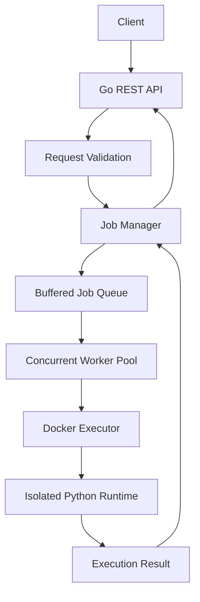
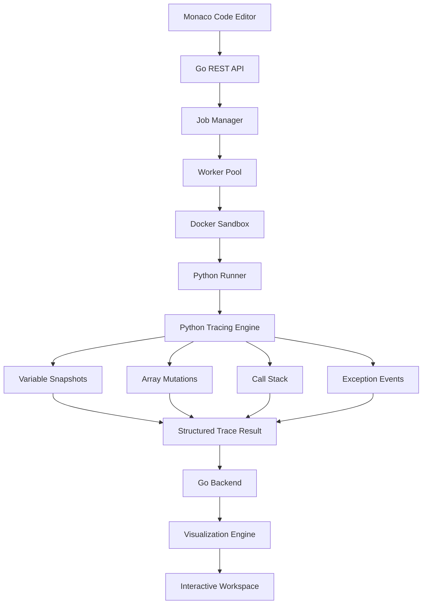
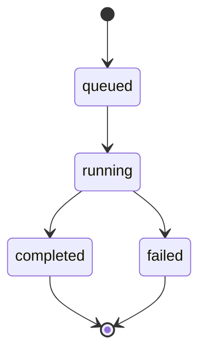

# AlgoTrace

**A concurrent code execution and interactive algorithm visualization engine built with Go, Python, and Docker.**

AlgoTrace aims to bridge the gap between writing code and understanding how it executes internally. It captures execution states, variable mutations, array operations, function calls, recursion, and exceptions to enable interactive, step-by-step algorithm visualization.

The project combines Go's concurrency capabilities with Python's runtime tracing and Docker-based execution isolation.

## Features

### Execution Backend

- REST API for asynchronous code execution.
- Concurrent job processing using a worker pool.
- Thread-safe job management.
- Docker-based execution isolation.
- Execution timeouts and automatic container cleanup.
- Bounded stdout and stderr capture.
- Strict request validation.
- Graceful server shutdown.

### Python Tracing Engine

- Line-by-line execution tracking.
- Variable creation, modification, and deletion.
- Array mutation tracking.
- Function arguments and return values.
- Recursive execution and call-stack tracking.
- Structured runtime and syntax errors.
- Handled and unhandled exception tracking.
- Bounded serialization and trace generation.
- Containerized Python tracing runtime.

### Planned Features

- End-to-end Go and Python tracer integration.
- WebSocket-based execution streaming.
- Monaco-powered code editor.
- Interactive algorithm visualization.
- Resizable split-screen workspace.
- Independent fullscreen editor and visualization panels.
- Synchronized source-code highlighting.
- Play, pause, restart, and step-by-step controls.
- Recursion trees and stack visualization.
- Persistent execution history.
- Support for additional programming languages.

## System Architecture

### Current Execution Backend



### Target Tracing Architecture



The Go execution backend and containerized Python tracer are independently implemented and tested. Their end-to-end integration is currently in development.

## Technology Stack

| Component | Technology |
|---|---|
| Backend | Go |
| Execution runtime | Python 3.12 |
| Tracing | Python sys.settrace |
| Containerization | Docker |
| Concurrency | Goroutines, Channels, Mutexes |
| Communication | REST API, JSON |
| Backend testing | Go Testing, Race Detector |
| Tracer testing | Python unittest |
| Frontend (planned) | React, Monaco Editor |
| Streaming (planned) | WebSockets |

## Project Structure

```text
algotrace/
├── cmd/
│   └── server/
│       ├── main.go
│       └── main_test.go
├── internal/
│   ├── executor/
│   │   ├── docker.go
│   │   ├── docker_test.go
│   │   └── trace.go
│   ├── jobs/
│   │   ├── manager.go
│   │   └── manager_test.go
│   └── tracer/
│       ├── tracer.py
│       ├── runner.py
│       ├── test_tracer.py
│       └── Dockerfile
├── .gitignore
├── go.mod
├── go.sum
└── README.md
```

## Execution Isolation

Submitted code is executed inside Docker containers with resource restrictions.

| Resource | Configured Limit |
|---|---|
| Execution timeout | 5 seconds |
| Container memory | 128 MiB |
| CPU allocation | 0.5 CPU |
| Process limit | 64 |
| Network access | Disabled |
| Filesystem | Read-only |
| Temporary storage | 16 MiB |
| Container user | Non-root |
| Linux capabilities | Dropped |
| Privilege escalation | Disabled |
| stdout | 1 MiB |
| stderr | 1 MiB |

These restrictions provide baseline execution isolation. Additional security hardening is required before exposing the service to arbitrary public workloads.

## Trace Limits

| Resource | Configured Limit |
|---|---|
| Maximum trace events | 10,000 |
| Maximum call depth | 100 |
| Maximum trace payload | 5 MiB |
| Maximum serialized value | 64 KiB |
| Maximum collection items | 500 |
| Maximum serialization depth | 8 |

## Getting Started

### Prerequisites

- Go 1.26 or a compatible version.
- Python 3.12 recommended.
- Docker Desktop or Docker Engine.
- Git.
- Compatible C compiler for Go race detection.

### Clone the Repository

```bash
git clone https://github.com/Srinu0725/algotrace.git
cd algotrace
```

### Download Go Dependencies

```bash
go mod download
```

### Download the Python Runtime Image

```bash
docker pull python:3.12-alpine
```

### Build the Tracing Image

```bash
docker build -t algotrace-python:dev ./internal/tracer
```

### Start the Backend

```bash
go run ./cmd/server
```

## API Reference

| Method | Endpoint | Description |
|---|---|---|
| GET | /health | Server health check |
| POST | /execute | Submit Python source code |
| GET | /jobs/{id} | Retrieve execution job status and result |

### Submit Code

POST /execute

```json
{
    "code": "x = 10\ny = 20\nprint(x + y)"
}
```

Execution requests are processed asynchronously through the job queue.

### Job Lifecycle



## Python Trace Example

The following example can be executed directly through the Python tracing runner.

```python
arr = [10, 20, 30]
arr.append(40)
arr[1] = 99
print(arr)
```

Illustrative variable-change event:

```json
{
    "type": "array_updated",
    "name": "arr",
    "old_value": [10, 20, 30, 40],
    "new_value": [10, 99, 30, 40]
}
```

The tracing engine also records source line numbers, function names, call-stack depth, variable snapshots, return values, and exception events.

These events will power the interactive visualization frontend.

## Testing

### Go Unit Tests

```bash
go test ./...
```

### Race Detection

```bash
go test -race ./...
```

### Static Analysis

```bash
go vet ./...
```

### Python Tracer Tests

```bash
python -m unittest discover -s internal/tracer -p "test_*.py" -v
```

### Windows Race Detector

On Windows, Go race detection requires CGO and a compatible 64-bit C compiler.

For an MSYS2 UCRT64 installation, configure PowerShell:

```powershell
$env:Path = "C:\msys64\ucrt64\bin;C:\Program Files\Go\bin;" + $env:Path
$env:CGO_ENABLED = "1"
$env:CC = "gcc"

go test -race ./...
```

Adjust the compiler path according to your installation.

## Development Roadmap

### Phase 1 — Backend Foundation

- [x] REST API
- [x] Concurrent job manager
- [x] Worker pool
- [x] Docker execution engine
- [x] Resource restrictions
- [x] Container lifecycle management
- [x] Graceful shutdown
- [x] Automated Go tests

### Phase 2 — Tracing Engine

- [x] Python execution tracing
- [x] Variable snapshots
- [x] Array mutation tracking
- [x] Function and recursion tracking
- [x] Exception handling
- [x] Trace safety limits
- [x] Automated Python tests
- [x] Bounded output capture
- [x] Custom Docker image
- [x] Go trace data models
- [ ] Go-Python integration
- [ ] Trace API endpoints
- [ ] End-to-end integration tests

### Phase 3 — Interactive Visualization

- [ ] Monaco code editor
- [ ] Resizable split-screen workspace
- [ ] Independent fullscreen panels
- [ ] Source-code synchronization
- [ ] Variable and array visualization
- [ ] Call-stack visualization
- [ ] Recursion trees
- [ ] Execution playback controls
- [ ] WebSocket streaming

### Phase 4 — Production Engineering

- [ ] GitHub Actions CI
- [ ] Persistent job storage
- [ ] Rate limiting
- [ ] Advanced sandbox isolation
- [ ] Observability and monitoring
- [ ] Performance benchmarking
- [ ] Cloud deployment
- [ ] Multi-language execution support

## Project Status

AlgoTrace is under active development.

The current focus is integrating the concurrent Go execution backend with the containerized Python tracing engine before building the interactive visualization workspace.

## Author

**Srinivas Teleti**

GitHub: [Srinu0725](https://github.com/Srinu0725)
